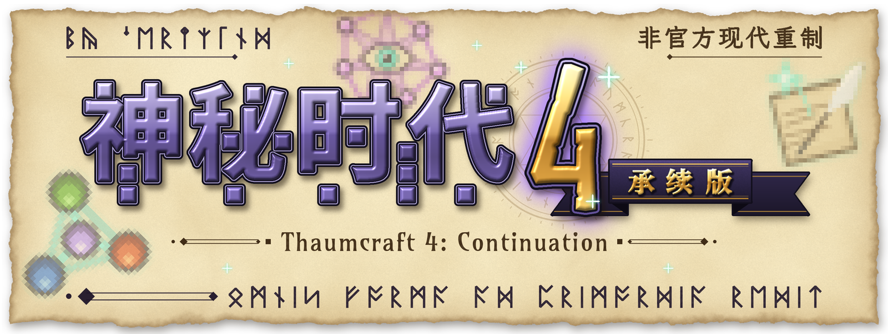

  

# 神秘时代 4：承续版（TC4C）系列

[English](README.md) | **简体中文**

在 Minecraft 1.20.1 的 Forge 上重制神秘时代 4 及围绕它成长起来的附属。本仓库收录整个系列的公开源码：本体、25 个附属和两个独立工具，各占一个顶层文件夹。

## 项目声明

本项目为由 Azanor 创作的 Minecraft mod《神秘时代》（Thaumcraft）及其附属在 Minecraft 1.20.1 下的重制。
本项目的主要玩法框架基于 1.7.10 的神秘时代 4 及其生态。

作者与 Mojang AB、Azanor、Team CoFH 及其他扩展原始 mod 作者均无关联。

本项目不分发任何未经授权的原始资源文件。要正常使用本项目，需将旧版本对应 mod 置于游戏运行目录内以读取资源。

AI 使用声明：本项目使用生成式 AI 进行开发。本项目原创内容中含有使用生成式 AI 创作的资源。

## 下载与游玩

- **下载 mod、体验整合包**：[tc4c.zer0m1nd.me][site]
- **QQ 群**：1125142992
- **问题反馈与建议**：[GitHub Issues][issues]

## 开始使用

- 全系列面向 Minecraft 1.20.1、Forge 47.x 与 Java 17。各项目的 README 写明了各自的最低 Forge 版本。
- 本体需要 [TerraBlender](https://www.mcmod.cn/class/5489.html) 和 [Curios API](https://www.mcmod.cn/class/2029.html)。所有附属都需要本体，其余前置见下方表格。
- 原作的图片、音效和旧语言文件从游戏运行目录的 `thaumcraft` 文件夹读取。客户端首次启动时会检查该文件夹，尝试从原下载渠道获取仍缺少的旧版 mod 文件，校验后只提取需要的资源。自动获取失败时，同一界面会提示要下载哪个文件、放到哪里。旧版 JAR 只当作数据读取，不要放进 `mods`。独立服务端不需要这些文件。
- 两个独立工具不依赖本体。

## 项目列表

每个条目链接到对应文件夹，其中有各自的 README、许可声明和构建文件。

稳定性标记：

| | 含义 |
| :-: | --- |
| 🟢 | 经过多名玩家实际游玩测试，已经可获得较好的游戏体验。 |
| 🟡 | 经过一定程度的测试和少量实际游玩，可能存在 bug，但总体可玩。 |
| 🔴 | 开发/移植初步完成但尚未经广泛测试，现阶段不建议加入游玩。 |

### 本体

| | 项目 | 原作 | 内容 | 前置 |
| :-: | --- | --- | --- | --- |
| 🟢 | [**神秘时代 4：承续版**](TC4/README.zh-CN.md) Thaumcraft 4: Continuation | Azanor 的 Thaumcraft 4 | 系列的核心。从扫描世界、认识要素开始，解锁研究、炼金、注魔、法杖与傀儡自动化。 | TerraBlender、Curios API |

### 附属

| | 项目 | 原作 | 内容 | 额外前置 |
| :-: | --- | --- | --- | --- |
| 🟢 | [**神秘万象**](ThaumicOmniverse/README.zh-CN.md) Thaumic Omniverse | 本系列原创 | 扩展实用魔法与现代模组联动：使用便捷源质设备、神秘调谐和魔法工具，并结合机械动力建造奥术飞艇与航线运输网络。 | 可选：机械动力 |
| 🟢 | [**神秘时代：未来**](ThaumicFutures/README.zh-CN.md) Thaumic Futures | Azanor 的 Thaumcraft 5、6 | 将神秘时代 5 的魔力碎片、锚钩、建筑法杖核心，以及神秘时代 6 的部分设备、工具与魔法机制带回神秘时代 4，并承接经典联动内容。 | |
| 🟢 | [**神秘工匠**](ThaumicTinkerer/README.zh-CN.md) Thaumic Tinkerer | Vazkii、pixlepix、nekosune 的 Thaumic Tinkerer | 用研究与注魔制作实用工具、附魔和高阶装备，逐步探索灵宝等后期魔法科技。 | |
| 🟢 | [**自动化魔法**](Automagy/README.zh-CN.md) Automagy | Tuhljin、Draanor 的 Automagy | 用魔法设备搭建物品整理、红石控制与源质自动化系统，扩展贪婪箱子、魔镜及傀儡的实用玩法。 | |
| 🟢 | [**禁忌魔法**](ForbiddenMagic/README.zh-CN.md) Forbidden Magic | SpitefulFox 的 Forbidden Magic | 探索七宗罪要素与禁忌研究，制作特殊法杖、工具和附魔。 | 可选：血魔法、植物魔法 |
| 🟢 | [**神秘能源**](ThaumicEnergistics/README.zh-CN.md) Thaumic Energistics | Nividica 的 Thaumic Energistics | 将源质存储与传输接入应用能源 ME 网络，集中管理源质并辅助炼金、注魔和魔法自动化。 | 应用能源 2 |
| 🟢 | [**神秘视界**](ThaumicHorizons/README.zh-CN.md) Thaumic Horizons | Kentington 的 Thaumic Horizons | 研究生物改造、灵魂与魔法装置，体验培养、注魔生物、特殊透镜和法杖核心等扩展内容。 | |
| 🟢 | [**神秘基础学**](ThaumicBases/README.zh-CN.md) Thaumic Bases | Modbder 的 Thaumic Bases | 为日常魔法生活补充作物、材料、工具与实用装置，并扩展法杖、装备和研究路线。 | |
| 🟡 | [**电力魔法工具**](ElectroMagicTools/README.zh-CN.md) Electro-Magic Tools | fewizz、TheSilentium 的 Electro-Magic Tools | 把电力科技与神秘研究连接起来，制作电力魔法工具、装备与设备。 | 工业时代 2 |
| 🟡 | [**魔像秘经**](Gadomancy/README.zh-CN.md) Gadomancy | makeo、HellFirePvP 的 Gadomancy | 扩展傀儡、节点与注魔设备，用新的魔法装置提升生产和研究能力。 | |
| 🟡 | [**节点力学**](NodalMechanics/README.zh-CN.md) Nodal Mechanics | Shukaro 的 Nodal Mechanics | 通过节点相关研究与合成，构造和培育灵气节点，为魔法设施提供更可控的节点来源。 | |
| 🟡 | [**污秽魔法**](TaintedMagic/README.zh-CN.md) Tainted Magic | John Yorke（tadashi_3）的 Tainted Magic | 深入污秽与扭曲主题的研究，获得影金装备、特殊法杖核心与高阶魔法物品。 | |
| 🟡 | [**神秘注魔**](ThaumicInfusion/README.zh-CN.md) Thaumic Infusion | DrunkMafia 的 Thaumic Infusion | 向世界中的方块注入要素，赋予方块不同的魔法效果，让建筑与机关具有新的用途。 | |
| 🟡 | [**神秘扭曲学**](WarpTheory/README.zh-CN.md) Warp Theory | Shukaro、thegreatunclean 的 Warp Theory | 为扭曲系统增加更多随机事件与异常效果，让研究禁忌知识的代价更加鲜明。 | |
| 🟡 | [**巫师宝具**](WitchingGadgets/README.zh-CN.md) Witching Gadgets | BluSunrize 的 Witching Gadgets | 加入实用饰品、披风、工具和魔法设备，扩展旅行、资源处理与节点相关玩法。 | |
| 🔴 | [**神秘议会**](ThaumicConcilium/README.zh-CN.md) Thaumic Concilium | Ilya3000、BreadX22 的 Thaumic Concilium | 研究裂隙、虚体与魔导师的秘密，制作法杖核心、法镯和魔法装置，探索新的生物、维度及附属联动。 | 禁忌魔法、神秘工匠 |
| 🔴 | [**神秘染料**](ThaumicDyes/README.zh-CN.md) Thaumic Dyes | KryptonCaptain、Amerem 的 Thaumic Dyes | 为神秘护甲加入染色与洗色，重现符文装备、升级和残酷面具，提供多套具有原版模型的护甲。 | |
| 🔴 | [**注魔酿造**](InfusionBrewing/README.zh-CN.md) Infusion Brewing | mariri 的 Infusion Brewing | 将药水酿造成可流动的液体，通过注魔延长时效、增强等级，制作持续耗魔的饰品与投掷药水的法杖核心，并升级刷怪笼。 | |
| 🔴 | [**奥法献祭学**](ArcaneArteries/README.zh-CN.md) Arcane Arteries | jordsta95、MaxIsH0t 的 Arcane Arteries | 以刀具、石板及符文衔接血魔法，提供自我献血、生物献祭与另一条祭坛材料路线。 | 血魔法 |
| 🔴 | [**奥法工程学**](ArcaneEngineering/README.zh-CN.md) Arcane Engineering | Eris Izalith（cadaverous_queen）的 Arcane Engineering | 连接神秘时代与沉浸工程：防腐木可升级法杖、神秘与虚空钻头、生物柴油推进靴，以及节点干扰器。 | 沉浸工程 |
| 🔴 | [**高等神秘学**](AdvancedThaumaturgy/README.zh-CN.md) Advanced Thaumaturgy | Lycaon 的 Advanced Thaumaturgy；MonzterAssassin、Nekosune、ToFam 的 Advanced Thaumaturgy 2 | 水银法杖与六种水晶升级、魔杖台、节点修改器、天域瓶、神秘肥料、源质引擎及微晶器。 | |
| 🔴 | [**失落遗物学**](ForgottenRelics/README.zh-CN.md) Forgotten Relics | Integral（Aizistral）的 Forgotten Relics | 探索失落研究，制作融合神秘时代与植物魔法的遗物、饰品和法术书。 | 植物魔法 |
| 🔴 | [**神秘探险**](ThaumicExploration/README.zh-CN.md) Thaumic Exploration | Flaxbeard、gaeakat（nekosune）的 Thaumic Exploration | 新增冥想之缸、无尽与永燃之瓮、共享容器、灵魂与腐化设备、杖柄杖端、饰品和两种魔法靴。 | |
| 🔴 | [**量子魔法**](Technomancy/README.zh-CN.md) Technomancy | Democretes、theflogat、Mordenkainen 的 Technomancy | 将源质、能量与仪式结合：量子罐和无线线圈、节点制造、矿物纯化、存在能量与十六种仪式。 | 可选：植物魔法、血魔法 |
| 🔴 | [**心血结晶**](Heartwork/README.zh-CN.md) The Heartwork | Mysterious Mountain Smith 的 The Heartwork | 钢材与军刀工具、料理和作物、命名刀与特殊技、拔刀注魔研究、能量刀，以及村庄职业与交易。 | 可选：拔刀剑 Resharped |

### 独立工具

| | 项目 | 用途 |
| :-: | --- | --- |
| 🟢 | [**ThaumcraftUpdater**](ThaumcraftUpdater/README.zh-CN.md) 神秘时代更新器 | 在 Forge 扫描模组前，按你的选择更新已安装的系列模组。独立启动工具，不属于神秘时代附属。 |
| 🟢 | [**ThaumcraftResourceAdapter**](ThaumcraftResourceAdapter/README.zh-CN.md) 资源包适配器 | 把为旧版神秘时代及附属制作的本地资源包转换成可在 Minecraft 1.20.1 启用的资源包。仅客户端使用。 |

## 如何构建

每个项目都可以用自己文件夹里的 Gradle Wrapper 单独构建。所需工具、依赖准备步骤和具体命令见各个子仓库的 README。

## 参与维护与扩展开发

- 此项目主要由生成式 AI 进行开发。建议使用 [MCModding](https://github.com/zer0M1nd/MCModding) 配合 Agent 维护此项目。
- 欢迎基于此版本开发扩展。如果缺少某些扩展实现所需的 API，欢迎在 [Issues][issues] 提出。我们期待一个内部无 Mixin 的生态。
- 推荐仓库：[Thaumifier](https://github.com/zer0M1nd/Thaumifier) 可用于让 AI 写出魔导手册风格的文本。

## 许可

本系列以 TC4Revival Noncommercial License 1.0 发布，即 PolyForm Noncommercial License 1.0.0 加上关于转售与付费整合包的附加条件。详见本目录的 [LICENSE](LICENSE) 与 [NOTICE](NOTICE)，以及各项目文件夹内的许可文件和声明。第三方材料沿用其自身条款。

[site]: http://tc4c.zer0m1nd.me
[issues]: https://github.com/zer0M1nd/Thaumcraft4C-Series/issues
